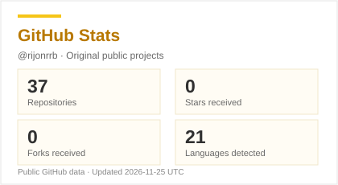
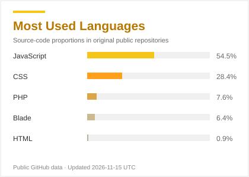

# Md. Sakib Hossain Rijon

### Software Engineer · Full-Stack, AI & API Integration Specialist

I build scalable web products and operational platforms—combining Laravel/PHP backends, AI-enabled workflows, payment systems, and dependable third-party integrations.

## 👋 About me

I am a full-stack software engineer experienced in e-commerce, SaaS, fintech, property management, education, security monitoring, transport, and AI-enabled document platforms. I take features from requirements through architecture, implementation, testing, deployment, and ongoing optimization.

My strengths are building robust Laravel applications, designing REST APIs, integrating complex external services, and making operational workflows simpler for real users.

## 💼 Professional experience

- **Software Engineer — Arobil IT Ltd.** · *Aug 2023–Present*  
  Developing and maintaining dynamic web applications, REST APIs, responsive interfaces, integrations, and scalable business systems.

- **Full-Stack Developer (Contractual) — Vyper Solutions** · *Mar 2023–Jun 2023*  
  Built Python/Django web applications and REST APIs, customized ISP portals with Django Sonar, and developed WordPress plugins.

- **IT Engineer Intern — Abdul Monem Limited** · *Sep 2022–Jan 2023*  
  Provided systems/network support and developed an internal Laravel inventory management system.

## 🤖 AI, SaaS & document intelligence

- AI-enabled workflows using **GPT, Claude, Gemini, and Ollama**
- Document intelligence: **OCR, structured data extraction, indexed retrieval, evidence-based AI assistants, routing, and generated workpapers**
- Multi-tenant SaaS: **tenant isolation, subscriptions, usage limits, team roles, invitations, billing, and audit trails**
- Production engineering: **queues, caching, chunked uploads, background processing, validation, logging, and performance optimization**

## 💳 Payments, APIs & connected systems

- Payment integration experience: **Stripe, PayPal, SSLCommerz, aamarPay, Paddle, Moneris, PayFast, Razorpay, PhonePe, and JazzCash**
- Financial workflows: **checkout, payment verification, subscriptions, invoices, cancellations/refunds, and currency-aware payment flows**
- API expertise: **REST, OAuth 2.0, webhooks, authentication, pagination, rate limits, error handling, and API documentation**
- Third-party integrations: **Microsoft Graph, OneDrive, Azure Document Intelligence, Billbee, BlockCypher, Firebase, Calendly, SMS/email, and courier APIs**
- Logistics providers: **Pathao, Steadfast, UPS, and Canada Post**
- Real-time product experience with **WebRTC** for web calls and broadcast/podcast platforms

## 🌟 Selected product portfolio

### Open-source & independent products

- **[SecureStream Player](https://github.com/rijonrrb/SecureStream-Player)** · [Live demo](https://rijonrrb.github.io/SecureStream-Player/) — reusable TypeScript video player offering HLS streaming, compatible audio/subtitle tracks, flexible playback controls, and experimental direct-container playback.
- **[NEXROOM](https://github.com/rijonrrb/NEXROOM)** · [Live beta](https://nexroom.devrijonn.com/) — browser-first real-time collaboration project with temporary rooms and working one-to-one WebRTC calls; messaging, screen sharing, and group collaboration are future goals.
- **[SCREENROOM](https://github.com/rijonrrb/screenroom)** · [Live website](https://screenroom.devrijonn.com/) — full-stack movie and series catalog with content Studio, TMDB metadata integration, and SecureStream-based playback for authorized media.
- **[Task Management Software](https://github.com/rijonrrb/Task-Management-Software)** — Laravel/Vue task organization, progress tracking, and career-path planning application. *In development.*

### Recent client & business platforms

- **[Fade Clips Barber](https://fadeclipsbarber.com/)** — barbershop POS and booking platform with appointments, walk-in checkout, staff commission workflows, and customer reviews.
- **Elite Auto Manager** — Laravel-based garage and automotive service management project for customer records, workflows, and structured data imports. *In development; no public demo currently listed.*

Projects are selected from my [portfolio](https://devrijonn.com/) and GitHub work. The list below also includes established business platforms across different industries.

**AI & document platforms**

- [MaildocAI](https://test.maildocai.com/) — automated email management, OCR/indexing, document routing, and an AI assistant
- [AIMateriality](https://test.aimateriality.com/) — audit-ready materiality workflow with AI assistance and workpapers

**SaaS & operational systems**

- [BDHousing](https://www.bdhousing.com/) — property management platform
- [HEConnect](https://dc-heconnect.com/) — multi-tenant university management system
- [RiskApp](https://risk-app.com/) — business risk management system
- [Defcon-App](https://defcon-app.com/) — cyber-security alarm monitoring system
- [TGA Grading](https://tgagrading.com/) — sports and TCG card grading workflow platform

**Commerce, inventory & customer platforms**

- [BuyWithMe](https://buywithme.shop/) — multi-vendor e-commerce platform
- [Everisamting](https://everisamting.com/) — e-commerce website
- [Skylil](https://skylil.com/) — inventory management system
- [Vinitycard](https://vinitycard.com/), [Connectify.Cards](https://connectify.cards/), and [Taponlink](https://taponlink.com/) — digital business card platforms
- [Enjoy City Tour](https://enjoycitytours.com/) — private transportation management system
- [212audio](https://unavo.xyz/) — broadcast, podcast, and real-time web-call management system
- [Cuts Without Borders](https://cutswithoutborders.com/) — barbershop management system
- [TCLI Library](https://tclilibrary.com/) — library management system

## 🛠️ Technology stack

Icons first, with labels for quick scanning. These technologies span professional work, personal projects, and ongoing learning; **the final group is an expanding toolkit, not a claim of equal production experience**.

### Backend & APIs

<table>
<tr>
<td align="center" width="110"> <strong>PHP</strong></td>
<td align="center" width="110"> <strong>Laravel</strong></td>
<td align="center" width="110"> <strong>Python</strong></td>
<td align="center" width="110"> <strong>Django</strong></td>
<td align="center" width="110"> <strong>Node.js</strong></td>
</tr>
<tr>
<td align="center" width="110"> <strong>Express.js</strong></td>
</tr>
</table>

### Frontend & programming languages

<table>
<tr>
<td align="center" width="110"> <strong>JavaScript</strong></td>
<td align="center" width="110"> <strong>TypeScript</strong></td>
<td align="center" width="110"> <strong>React</strong></td>
<td align="center" width="110"> <strong>Vue.js</strong></td>
<td align="center" width="110"> <strong>HTML5</strong></td>
</tr>
<tr>
<td align="center" width="110"> <strong>CSS3</strong></td>
<td align="center" width="110"> <strong>Tailwind CSS</strong></td>
<td align="center" width="110"> <strong>Bootstrap</strong></td>
<td align="center" width="110"> <strong>C</strong></td>
<td align="center" width="110"> <strong>C++</strong></td>
</tr>
</table>

### Databases & caching

<table>
<tr>
<td align="center" width="110"> <strong>MySQL</strong></td>
<td align="center" width="110"> <strong>MS SQL Server</strong></td>
<td align="center" width="110"> <strong>Oracle SQL</strong></td>
<td align="center" width="110"> <strong>Redis</strong></td>
</tr>
</table>

### Cloud, tooling & delivery

<table>
<tr>
<td align="center" width="110"> <strong>Docker</strong></td>
<td align="center" width="110"> <strong>Git</strong></td>
<td align="center" width="110"> <strong>GitHub</strong></td>
<td align="center" width="110"> <strong>GitHub Actions</strong></td>
<td align="center" width="110"> <strong>Microsoft Azure</strong></td>
</tr>
<tr>
<td align="center" width="110"> <strong>Google Cloud</strong></td>
<td align="center" width="110"> <strong>Firebase</strong></td>
<td align="center" width="110"> <strong>Cloudflare</strong></td>
<td align="center" width="110"> <strong>Linux</strong></td>
<td align="center" width="110"> <strong>Postman</strong></td>
</tr>
<tr>
<td align="center" width="110"> <strong>WordPress</strong></td>
</tr>
</table>

### Recently learning & expanding

<table>
<tr>
<td align="center" width="110"> <strong>Next.js</strong></td>
<td align="center" width="110"> <strong>NestJS</strong></td>
<td align="center" width="110"> <strong>PostgreSQL</strong></td>
<td align="center" width="110"> <strong>MongoDB</strong></td>
</tr>
</table>

**Also working with:** REST APIs, OAuth 2.0, webhooks, payment integrations, WebRTC, HLS streaming, media storage and signed URLs, CI/CD pipelines, test automation, and performance optimization.

## 🏅 Education & recognition

- **B.Sc. in Computer Science & Engineering**, American International University-Bangladesh (AIUB)
- **Certificate with Honors** — Duke University, *Programming Foundations with JavaScript, HTML and CSS*
- Participant — Cisco Networking Academy Skills Competition Bangladesh
- Participant — Youth Speak Forum 2019, powered by AIESEC

## 🧪 Recently built & learned

- **Media engineering:** TypeScript libraries, adaptive HLS playback, subtitle/audio track handling, browser compatibility, and reusable player interfaces through SecureStream Player.
- **Real-time communication:** WebRTC calling, WebSocket signaling, temporary rooms, device permissions, and reconnection workflows through NEXROOM.
- **Full-stack media platforms:** content-management APIs, movie/series data models, metadata integration, and protected media-source access through SCREENROOM.
- **Developer workflows:** GitHub Actions CI/CD, automated testing and deployment, version-control collaboration, and Docker fundamentals.
- **Modern web & data:** stronger TypeScript and Node.js skills; currently expanding into Next.js, NestJS, PostgreSQL, and MongoDB.

## 🚀 Current focus

- **AI-assisted software development:** experimenting with local AI models, coding assistants, multi-agent collaboration, and turning new ideas into useful developer tools.
- **Open-source engineering:** evolving SecureStream Player and NEXROOM with an emphasis on playback, real-time UX, accessibility, and cross-browser reliability.
- **Production-minded SaaS development:** improving business platforms, booking/POS workflows, media catalogs, and API integrations with careful attention to security, quality, and performance.
- **Modern architecture & delivery:** TypeScript, Node.js, Next.js/NestJS learning, PostgreSQL/MongoDB exploration, Docker, and maintainable CI/CD pipelines.
- **Practical problem-solving:** building dependable systems that reduce friction for clients and end users.

## 📈 GitHub activity

  

<!-- 

  
  

Language figures reflect public repository code, not proficiency.
 -->

### Let’s build something valuable

